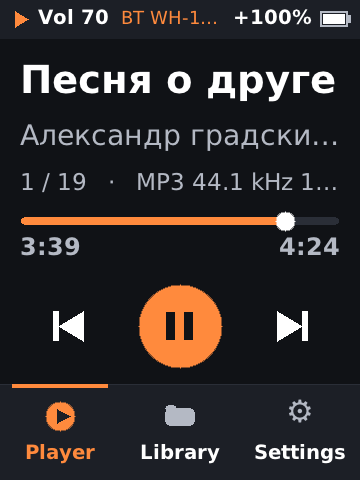
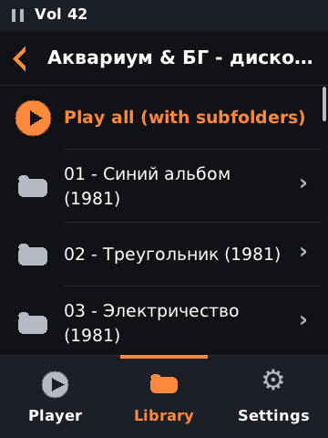
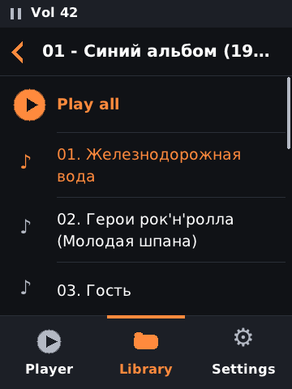
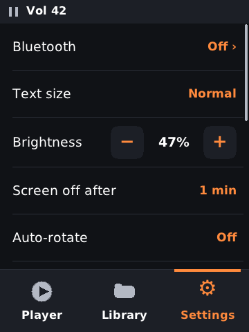
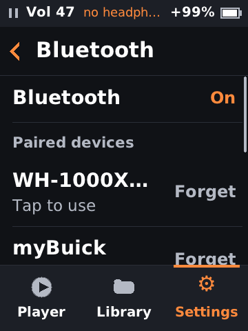
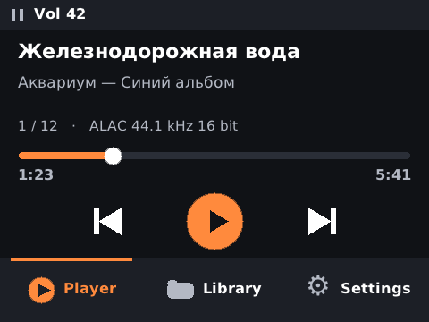

# AP80 Pro-X custom player

A small, fast replacement UI for the **Hidizs AP80 Pro-X** portable music player. It replaces the
stock HiBy player app with a simple one and keeps HiBy's Linux and drivers.

Plug in headphones (or pick Bluetooth headphones), browse the SD card by folder, and play a song or
a whole folder. Large, readable type; no album art, e-book reader or step counter.

<table>
  <tr>
    <td></td>
    <td></td>
    <td></td>
  </tr>
  <tr>
    <td></td>
    <td></td>
    <td></td>
  </tr>
</table>

> **Warning:** this project involves flashing modified firmware and running unofficial software
> on the device. It is not affiliated with or endorsed by Hidizs or HiBy. Doing this may void your
> warranty, and it can brick the device or lose data on the SD card. You do it at your own risk.
> Make a full NAND backup first.

## Features

### Playback
- **Many formats** (see the table below), up to 24-bit/384 kHz output, and DSD.
- **Gapless** between tracks with the same sample rate: the output stays open from one track to the
  next.
- **Folder queue:** tap a song to play it and the rest of its folder, or **Play all** to play a
  folder with all its subfolders.
- **Resume:** on boot the player opens paused at the last track and position (or keeps playing,
  if you choose that in Settings).
- **Draggable seek bar**, previous / play-pause / next.
- **Tags:** title, artist and album from Vorbis comments, ID3 (including CP1251 Cyrillic) and MP4
  tags; the file name is used when there are none.
- **DAC filter:** the ES9219's 8 digital filters, selectable in Settings.

### Bluetooth
- Play to **Bluetooth headphones, speakers or a car** (A2DP). The stock BlueZ stack picks the codec:
  **LDAC**, aptX, AAC or SBC.
- Scan for new devices and pair them, use a paired device with one tap, forget a device (with a
  confirming second tap).
- A paired device that connects by itself (headphones switched on, the car) becomes the output.
- Separate volume for Bluetooth and for the headphone jack. Plugging into the jack always uses
  the jack; unplugging it pauses.

### Interface
- **Tray** with big Player / Library / Settings buttons, and a status line with play state, volume,
  output and battery.
- **Text size:** Normal, Large, Larger or Largest. Long names wrap instead of being cut off.
- **Portrait or landscape**, either way up: a fixed orientation or phone-style **auto-rotate**.
- **Smooth scrolling** lists, toasts for volume and events.
- **Hardware controls:** play/pause, next/prev, the volume knob (1, 2 or 3 steps per click), and
  power (short press = screen on/off, long press = power off).

### Settings
Bluetooth, text size, brightness, screen-off timeout, auto-rotate, orientation, max volume, volume
step, DAC filter, start paused or resume playing, USB storage, switch to the stock player, power off.

### USB
- **USB storage mode:** when a computer is connected the player offers to export the SD card as a
  drive, so music can be copied over. It returns to the library when the drive is ejected.
- **Stock player:** one tap switches to the stock HiBy player for one boot.

## Supported formats
| Format | Extensions | Decoder |
|---|---|---|
| FLAC | `.flac` | dr_flac |
| MP3 | `.mp3` | dr_mp3 |
| WAV | `.wav` | dr_wav |
| Apple Lossless (ALAC), AAC | `.m4a` `.m4b` `.mp4` `.alac` `.aac` `.caf` | FFmpeg |
| Ogg Vorbis, Opus | `.ogg` `.oga` `.opus` | FFmpeg |
| Monkey's Audio, WavPack, TTA, TAK | `.ape` `.wv` `.tta` `.tak` | FFmpeg |
| AIFF, Wave64 | `.aif` `.aiff` `.aifc` `.w64` | FFmpeg |
| WMA, WMA Pro, WMA Lossless | `.wma` | FFmpeg |
| Musepack, MP2 | `.mpc` `.mp2` | FFmpeg |
| Matroska audio | `.mka` | FFmpeg |
| DSD (played as PCM, up to 192 kHz) | `.dsf` `.dff` | FFmpeg |

Lossless formats decode bit-exactly. Multichannel files are played as their first two channels.

## How it runs on the device
The device is an Ingenic X1000 (MIPS32r2) with 64 MB RAM, Linux 3.10 and a 360×480 touch screen.

1. The device is flashed with stock firmware 1.1, modified in one place: the
   `S92_03_start_music_player` init script (`firmware/mod/overlay`).
2. That init hook runs `ap80dev/boot.sh` from the SD card. If `ap80dev/no_stock` exists, the
   stock player is skipped.
3. `boot.sh` (`sdcard/ap80dev/boot.sh`) keeps ADB on and runs `ap80dev/player/ap80player` in a
   loop. If the app crashes repeatedly, it falls back to the stock player.

The stock firmware 1.1 image (`.upt`) is needed to rebuild the patched firmware, but it isn't
included in this repo.

## Layout
| Path | Contents |
|---|---|
| `app/player` | The player: C, framebuffer UI, tinyalsa output, dr_flac/dr_mp3/dr_wav and FFmpeg decoders, stb_truetype text |
| `app/fbtest`, `app/hello`, `app/acctest` | Hardware experiments |
| `sdcard/ap80dev` | Files that go on the SD card (`boot.sh`, flag files) |
| `firmware/mod/overlay` | The one file changed in the stock rootfs |
| `tools/Dockerfile` | Cross toolchain image `ap80-tc` (Debian, mipsel gcc, UBI/ISO tools, qemu) |
| `tools/scripts` | Firmware unpack/repack (`roundtrip.sh`, `build_upt.sh`, `verify.sh`) and qemu helpers |
| `tools/deploy.sh`, `tools/shot.sh` | Build + push + restart over ADB; take a screenshot |
| `tools/scripts/preview.sh` | Headless UI preview under qemu (portrait + landscape screenshots) |
| `docs/hardware.md` | Hardware notes: display ioctls, inputs, ALSA controls, USB gadget, pitfalls |
| `docs/stock_features.md` | Inventory of stock firmware features |
| `docs/img`, `screenshots` | UI screenshots |

## Build and deploy
```sh
git submodule update --init                      # tinyalsa
docker build -t ap80-tc tools                      # once
tools/build_ffmpeg.sh                              # once: downloads and cross-builds a small FFmpeg
tools/deploy.sh                                     # build, push to the SD card over ADB, restart the app
tools/shot.sh player                                # saves screenshots/player.png
```
Running the app needs the patched firmware and the `ap80dev/adb` and `ap80dev/no_stock` flag
files on the card.

### Debug FIFO
While the app runs it reads commands from `/tmp/ap80p.cmd` on the device:
- `tap x y`
- `drag x1 y1 x2 y2`
- `key play|next|prev|up|down|power`
- `shot PATH`
- `restart`
- `quit`

## Things to know
- Volume is an attenuation scale: 0 is loudest and 255 is mute.
- Don't put the LCD controller to sleep (`SET_SLEEP` 1): it can hang the display driver. The app
  only turns the backlight off.
- The kx126 accelerometer driver's event stream doesn't work; auto-rotate reads the chip's registers
  through the driver's `reg_read` debug hook and dynamic debug (`/dev/kmsg`). See `docs/hardware.md`.
- Avoid hard resets while the SD card is mounted. One unclean reset wiped the `ap80dev` folder.
- To return to stock, remove `ap80dev/no_stock`, or flash the stock or rollback `.upt`.

## License
The code in this repo is MIT-licensed; see `LICENSE`. Third-party components keep their own
licenses:
- dr_flac, dr_mp3 and dr_wav: public domain or MIT-0
- stb_truetype: public domain or MIT
- tinyalsa: BSD-3-Clause; a git submodule
- FFmpeg (libavformat, libavcodec, libswresample, libavutil): LGPL 2.1 or later. It is downloaded
  and built by `tools/build_ffmpeg.sh` (audio decoders only) and linked statically; the full source
  of this app is here, so the binary can be relinked against a modified FFmpeg
- DejaVu fonts: the Bitstream Vera / DejaVu license

Hidizs and HiBy firmware isn't included.
